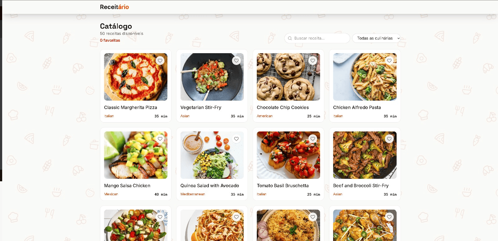

# Receitário

Catálogo de receitas em **React + Vite + TypeScript** que consome a [DummyJSON](https://dummyjson.com/docs/recipes). Checkpoint 5 (FIAP · Frontend).

Tecnologias: React, Vite, TypeScript, Tailwind CSS, lucide-react, react-router-dom e react-error-boundary.

## Integrantes

| Nome | RM |
| ---- | -- |
| Leonardo Afonço Sousa | RM573982 |
| Vitor Gonçalves de Souza | RM569023 |
| Syang Cristina Gomes Souza | RM569259 |
| João Machado Nascimento | RM572364 |
| Matheus Jones Sousa de Freitas | RM573559 |

## Deploy

[https://receitario-cp5.vercel.app](https://receitario-cp5.vercel.app)

## Print do catálogo



## Como rodar

Requisitos: Node.js 20 ou superior.

```bash
npm install      # instala as dependências
npm run dev      # inicia o servidor de desenvolvimento
npm run build    # checa o TypeScript e gera a pasta dist/
npm run lint     # roda o ESLint
npm run preview  # serve o build localmente
```

## Rotas

| Rota | Tela |
| ---- | ---- |
| `/` | Catálogo: grid de cards, busca por nome, filtro por culinária, favoritar e contador de favoritas (o logo leva para cá) |
| `/receitas/:id` | Detalhe: imagem, ingredientes, modo de preparo e tempos; mostra "Receita não encontrada" quando a API responde 404 |
| `*` | 404 com link de volta ao catálogo |

## API

- `GET https://dummyjson.com/recipes?limit=0`: lista completa (50 receitas), dentro de `{ recipes, total, skip, limit }`
- `GET https://dummyjson.com/recipes/{id}`: detalhe; o 404 é tratado na tela

## Estrutura

```
src/
  components/  Header, RecipeCard, RecipeList, skeletons, ErrorFallback
  hooks/       useRecipes
  layouts/     MainLayout (header, footer e ErrorBoundary)
  pages/       CatalogPage, RecipePage, NotFoundPage
  services/    recipes.ts
  types/       recipe.ts, recipesResponse.ts
  utils/       formatTime.ts
```

Os favoritos ficam em estado local da `CatalogPage` (`useState<number[]>`), e a função `toggleFavorite` desce por props para `RecipeList` → `RecipeCard`. Eles não aparecem no header e não persistem ao trocar de página, como pede o enunciado.

## Deploy na Vercel

Importe o repositório (preset Vite). O `vercel.json` redireciona todas as rotas para o `index.html`, para `/receitas/:id` funcionar ao recarregar a página.

## Git Flow

1. `main` e `develop` desde o primeiro dia; nenhum commit direto na `main`.
2. Ao menos 3 branches `feature/*` (ex.: `feature/setup`, `feature/catalogo`, `feature/detalhe`) mergeadas na `develop` por Pull Request.
3. Cada integrante com commits e ao menos 1 PR.
4. Release: `release/1.0.0` a partir da `develop`, PR para a `main`, tag `v1.0.0` e Release no GitHub.
5. Commits em Conventional Commits, no formato `tipo: descrição` (com espaço depois dos dois-pontos), ex.: `feat: adiciona filtro por culinária`. Tipos: `feat`, `fix`, `refactor`, `style`, `docs`.
6. Antes de commitar, cada integrante configura o próprio nome e o e-mail da sua conta do GitHub no repositório, para os commits contarem no perfil certo:

   ```bash
   git config user.name "Seu Nome"
   git config user.email "seu-email-do-github@exemplo.com"
   ```
Receitário
Catálogo de receitas em React + Vite + TypeScript que consome a DummyJSON. Checkpoint 5 (FIAP · Frontend).

Tecnologias: React, Vite, TypeScript, Tailwind CSS, lucide-react, react-router-dom e react-error-boundary.

Integrantes
Nome	RM
Leonardo Afonço Sousa	RM573982
Vitor Gonçalves de Souza	RM569023
Syang Cristina Gomes Souza	RM569259
João Machado Nascimento	RM572364
Matheus Jones Sousa de Freitas	RM573559
Deploy
TODO: colar aqui a URL pública da Vercel depois do deploy.

Print do catálogo
TODO: adicionar aqui o print da tela do catálogo (/) depois do deploy.

Como rodar
Requisitos: Node.js 20 ou superior.

npm install      # instala as dependências
npm run dev      # inicia o servidor de desenvolvimento
npm run build    # checa o TypeScript e gera a pasta dist/
npm run lint     # roda o ESLint
npm run preview  # serve o build localmente
Rotas
Rota	Tela
/	Catálogo: grid de cards, busca por nome, filtro por culinária, favoritar e contador de favoritas (o logo leva para cá)
/receitas/:id	Detalhe: imagem, ingredientes, modo de preparo e tempos; mostra "Receita não encontrada" quando a API responde 404
*	404 com link de volta ao catálogo
API
GET https://dummyjson.com/recipes?limit=0: lista completa (50 receitas), dentro de { recipes, total, skip, limit }
GET https://dummyjson.com/recipes/{id}: detalhe; o 404 é tratado na tela
Estrutura
src/
  components/  Header, RecipeCard, RecipeList, skeletons, ErrorFallback
  hooks/       useRecipes
  layouts/     MainLayout (header, footer e ErrorBoundary)
  pages/       CatalogPage, RecipePage, NotFoundPage
  services/    recipes.ts
  types/       recipe.ts, recipesResponse.ts
  utils/       formatTime.ts
Os favoritos ficam em estado local da CatalogPage (useState<number[]>), e a função toggleFavorite desce por props para RecipeList → RecipeCard. Eles não aparecem no header e não persistem ao trocar de página, como pede o enunciado.

Deploy na Vercel
Importe o repositório (preset Vite). O vercel.json redireciona todas as rotas para o index.html, para /receitas/:id funcionar ao recarregar a página.

Git Flow
main e develop desde o primeiro dia; nenhum commit direto na main.

Ao menos 3 branches feature/* (ex.: feature/setup, feature/catalogo, feature/detalhe) mergeadas na develop por Pull Request.

Cada integrante com commits e ao menos 1 PR.

Release: release/1.0.0 a partir da develop, PR para a main, tag v1.0.0 e Release no GitHub.

Commits em Conventional Commits, no formato tipo: descrição (com espaço depois dos dois-pontos), ex.: feat: adiciona filtro por culinária. Tipos: feat, fix, refactor, style, docs.

Antes de commitar, cada integrante configura o próprio nome e o e-mail da sua conta do GitHub no repositório, para os commits contarem no perfil certo:

git config user.name "Seu Nome"
git config user.email "seu-email-do-github@exemplo.com"